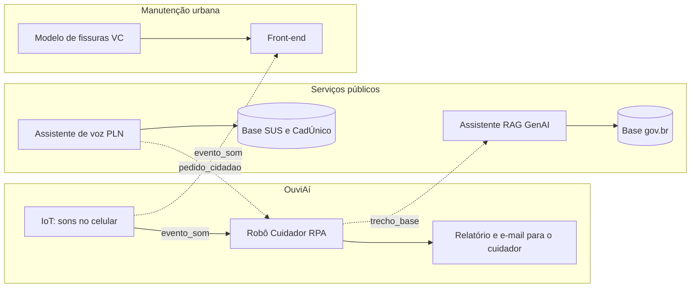

# Global Solution 2026.2 · CitizenTech

FIAP · Tecnólogo em Inteligência Artificial · turma 2TIAP

| Integrante | RM |
| --- | --- |
| Alexandre Ferreira | 565626 |
| Carlos Eduardo | 555812 |
| Filipe Melo | 564571 |

Este repositório reúne os itens desenvolvidos e entregues em cada disciplina da GS. A solução foi dividida por disciplina e acabou com três temas: o **OuviAí**, que reconhece sons da casa para avisar uma pessoa com deficiência auditiva (IoT e RPA), um assistente de **serviços públicos** por voz e texto (PLN e GenAI) e a **manutenção urbana** (Front-end e Visão Computacional). A pasta [`governanca/`](governanca/) mostra o que foi e o que não foi integrado.

## Links

| Entrega | Link |
| --- | --- |
| Vídeo de Governança em IA e Business Analytics | **PREENCHER (YouTube, não listado)** |
| Relatório de Governança (ABNT/FIAP) | **PREENCHER** |
| Vídeo IoT (teste ao vivo) | https://youtube.com/shorts/_qvth7-RmWA |
| Vídeo PLN | https://youtu.be/u5V6h_HPIoY |
| Vídeo GenAI | https://youtu.be/Vuh5_UaCfeo |
| Vídeo Visão Computacional | https://youtu.be/RdhAdSJ7MaY |
| Vídeo Front-end | **PREENCHER** |
| Vídeo RPA | **PREENCHER** |
| Deploy do Front-end | **PREENCHER** |

## Disciplinas e pastas

| Disciplina | Pasta | O que está lá | Tema |
| --- | --- | --- | --- |
| Physical Computing (IoT) | [`iot-ouviai/`](iot-ouviai/) | Relatório do classificador de sons no Edge Impulse | OuviAí |
| AI for RPA | [`RPA/rpa-ouviai/`](RPA/rpa-ouviai/) | Robô Cuidador: código, testes, contrato de integração e exemplos de saída | OuviAí, consome os eventos do IoT |
| PLN | [`pln-assistente-voz/`](pln-assistente-voz/) | Relatório e link da entrega do assistente de voz | Serviços públicos (SUS e CadÚnico) |
| Generative AI | [`genai-rag/`](genai-rag/) | Notebook e documentação do assistente RAG | Serviços públicos (gov.br) |
| Front-end em Sistemas de IA | [`citizentech/`](citizentech/) | Streamlit + FastAPI + LLM | Manutenção urbana |
| Visão Computacional | [`visao-computacional/`](visao-computacional/) | Notebook e relatório do modelo de fissuras | Manutenção urbana, usado pelo Front-end |
| Cluster Computing | [`cluster-ispd/`](cluster-ispd/) | Relatório da simulação no iSPD | Carga de inferência da solução |
| Computação Quântica | [`quantica/`](quantica/) | Análise sem código: gargalo, capacidade e roadmap | OuviAí |
| Governança em IA e BA | [`governanca/`](governanca/) | Quadro de integração, Model Cards, controles e termo de consentimento | Todos |

## Como os módulos trocam dados

O formato previsto para os dados entre os módulos está no [contrato de integração](RPA/rpa-ouviai/contrato_integracao_ouviai.json) (JSON Schema, versão 1.0.0). As linhas cheias existem; as tracejadas estão no contrato e não foram implementadas.



## Como executar

Cada pasta tem o seu README. O código executável (Front-end e RPA) também sobe com Docker a partir da raiz, com o Docker Desktop aberto:

```bash
make preparar      # cria os .env a partir dos exemplos e faz o build das imagens
make front         # API FastAPI + Streamlit em http://localhost:8501
make rpa           # Robô Cuidador com a semana de demonstração, abre o relatório e o log
make testes        # pytest do Front-end
make rpa-testes    # pytest do robô
make parar         # derruba tudo
```

`make ajuda` lista os outros atalhos. Sem `make`, os mesmos comandos estão no `compose.yaml` (por exemplo `docker compose up -d --build` e `docker compose run --rm rpa`).

- Front-end: [`citizentech/README.md`](citizentech/README.md). Precisa de `ANTHROPIC_API_KEY` em `citizentech/.env`.
- RPA: [`RPA/rpa-ouviai/README.md`](RPA/rpa-ouviai/README.md). Nenhuma chave é obrigatória.
- GenAI e Visão Computacional: notebooks para o Google Colab nas pastas de cada disciplina, com as saídas salvas.
- IoT, PLN, Cluster e Computação Quântica: relatórios e vídeos nas pastas de cada disciplina.
