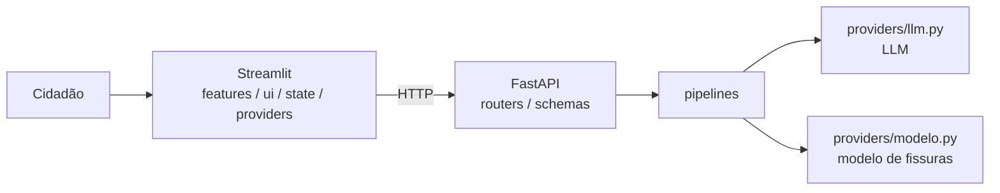

# CitizenTech – Manutenção Urbana

> Global Solution 2026/2 – Front-end em Sistemas de IA (FIAP)
> Integrantes: **PREENCHER** | Deploy: **PREENCHER (URL) ou instruções Docker abaixo** | Vídeo: **PREENCHER**

## 1. Problema e público
**PREENCHER:** quem é afetado, qual a dor concreta e a **fonte** que a sustenta (dado, notícia, relato ou entrevista, com link).

O cidadão relata buracos, fissuras e outros danos em vias e edificações (texto + foto opcional). A solução classifica o relato, indica a urgência e orienta o encaminhamento, apoiando a triagem de inspeções pela prefeitura.

## 2. Fluxo CitizenTech
1. **Entrada:** formulário com validação (descrição 10–1000 caracteres, local obrigatório, foto JPG/PNG até 5 MB).
2. **Processamento:** o front chama a API FastAPI; **só o back-end** chama o LLM e devolve JSON validado por Pydantic. A foto passa por um modelo de visão (MobileNetV2) treinado pelo grupo na disciplina de Visão Computacional.
3. **Resposta:** cartão com urgência (cor + ícone + texto), orientação, encaminhamento e protocolo.
4. **Human-in-the-loop:** o cidadão confirma ou **corrige** categoria e urgência antes de registrar. O painel mostra o % de relatos corrigidos.
5. **Painel:** gráficos Plotly com filtros por categoria e urgência.

## 3. Arquitetura

```
frontend/  features/ (telas)  ui/ (componentes)  state/ (estado)  providers/ (cliente HTTP)
backend/   routers/ (endpoints)  schemas/ (Pydantic)  pipelines/ (lógica de IA)  providers/ (LLM e modelo)
tests/     pytest dos pipelines e da API (sem subir a interface e sem chamar o LLM real)
```

## 4. Como executar
### Local
```bash
python -m venv .venv && source .venv/bin/activate     # Windows: .venv\Scripts\Activate.ps1
pip install -r backend/requirements.txt -r frontend/requirements.txt
cp .env.example .env                                   # preencha ANTHROPIC_API_KEY
# terminal 1
cd backend && uvicorn main:app --reload
# terminal 2
cd frontend && streamlit run app.py
```
Front: http://localhost:8501 · Documentação da API: http://localhost:8000/docs

### Docker
```bash
cp .env.example .env        # preencha ANTHROPIC_API_KEY
docker compose up --build
```
Para ativar a análise de foto: coloque `modelo.keras` em `models/` e troque `INSTALL_VISION` para `"true"` no `docker-compose.yml`. Sem o modelo, a API responde 503 e o front segue só com o texto.

### Testes
```bash
pip install -r tests/requirements-dev.txt -r backend/requirements.txt
pytest tests
```

## 5. Justificativas
### ODS
**PREENCHER** 1 ou 2 ODS com justificativa (sugestões: ODS 11 – Cidades e Comunidades Sustentáveis; ODS 9 – Indústria, Inovação e Infraestrutura).

### Decisões técnicas
- **Streamlit:** **PREENCHER** (por que, e não Gradio).
- **Prompt e formato de saída:** JSON com campos fechados (enums) validado por Pydantic; o prompt trata o relato como dado e ignora instruções dentro dele (mitiga injeção de prompt).
- **Deploy:** **PREENCHER**.
- **Cache:** `st.cache_data` (TTL 10 min) evita repetir a chamada ao LLM a cada *rerun*. Estado em `st.session_state` (`state/store.py`).
- **Segurança:** chave em variável de ambiente (`.env` fora do Git, `.env.example` versionado); CORS restrito às origens de `ALLOWED_ORIGINS`; entrada validada no back-end; erros técnicos nunca chegam ao cidadão; texto gerado pela IA é escapado antes de ir ao HTML.

### Ética e limites da IA
**PREENCHER/AJUSTAR:** riscos (erro, viés, alucinação, uso indevido). A solução **não** determina gravidade nem segurança estrutural; apenas apoia a triagem. A confirmação humana antes do registro mitiga erros. Não são coletados dados pessoais além do local informado.

### Acessibilidade aplicada
- Urgência indicada por **cor + ícone + texto**, nunca só pela cor.
- Cores com contraste adequado (texto branco/preto sobre fundo escolhido para contraste).
- Todos os campos com rótulo; mensagens de erro em linguagem simples; `role="alert"` nos cartões.
- **PREENCHER** o que mais foi aplicado (ex.: checklist WCAG).

## 6. Validação
### (a) Teste com pessoas do público-alvo
| Pessoa | Perfil | Tarefa | Observação | Ajuste feito |
|---|---|---|---|---|
| 1 | PREENCHER | | | |
| 2 | | | | |
| 3 | | | | |

### (b) Casos de teste da IA
| # | Entrada | Saída esperada | Saída obtida | Ajuste realizado |
|---|---|---|---|---|
| 1 | PREENCHER | | | |
| 2 | | | | |
| 3 | | | | |
